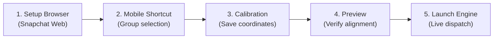

<div align="center">

# ⚡ Snap Automation Engine Pro (SAE-Pro)

**Next-generation, anti-detection macro automation suite for Snapchat Web**

[](https://www.python.org/downloads/)
[](https://microsoft.com/windows)
[](https://github.com/n1n00737)
[]()
[](LICENSE)

<br/>

```
  ███████╗███╗   ██╗ █████╗ ██████╗ ███████╗███╗   ██╗ █████╗ ██████╗ 
  ██╔════╝████╗  ██║██╔══██╗██╔══██╗██╔════╝████╗  ██║██╔══██╗██╔══██╗
  ███████╗██╔██╗ ██║███████║██████╔╝███████╗██╔██╗ ██║███████║██████╔╝
  ╚════██║██║╚██╗██║██╔══██║██╔═══╝ ╚════██║██║╚██╗██║██╔══██║██╔═══╝ 
  ███████║██║ ╚████║██║  ██║██║     ███████║██║ ╚████║██║  ██║██║     
  ╚══════╝╚═╝  ╚═══╝╚═╝  ╚═╝╚═╝     ╚══════╝╚═╝  ╚═══╝╚═╝  ╚═╝╚═╝     
                     SNAP AUTOMATION ENGINE PRO
```

</div>

---

## 📖 Overview

**Snap Automation Engine Pro (`SAE-Pro`)** is an advanced, high-performance desktop automation toolkit developed by **n1n00737**. Engineered specifically for **Snapchat Web**, it provides an intelligent, human-like automated dispatch cycle designed to dramatically scale snap delivery while actively evading automated bot detection heuristics.

---

## 🌟 Key Highlights & Engineering Features

| Capability | Description |
| :--- | :--- |
| 🧠 **Humanized Motion** | Implements smooth Bézier curve interpolation (`easeInOutQuad`) and randomized target pixel jitter (±3px). |
| 🛡️ **Anti-Flood Engine** | Configurable micro-breaks (e.g. 12s cool-down every 30 cycles) to simulate organic user pauses and bypass rate limits. |
| 💾 **Coordinate Caching** | Calibrate once: recorded screen coordinates are serialized to `config.json` for one-click startup in future sessions. |
| 🔍 **Crosshair Verification** | Preview registered coordinates across your display before engaging dispatch mode. |
| ⏸️ **Live Lifecycle Controls** | Real-time interactive hotkeys: Pause/Resume (`[P]`), Clean Stop (`[Q]` / `[ESC]`), and instant mouse corner failsafe. |
| 📊 **Real-time Telemetry** | Tracks session duration, delivery velocity (`snaps/min`), cycle counter, and persistent all-time lifetime stats. |
| 🔊 **Auditory Cues** | Subtle frequency-tuned sound notifications for calibration registration, state transitions, and cool-down breaks. |

---

## 🥊 SAE-Pro vs Generic Open-Source Scripts

| Feature | Generic Github Scripts | **SAE-Pro (by n1n00737)** |
| :--- | :---: | :---: |
| **Cursor Pathing** | Teleports instantly (easily flagged) | **Natural Bézier curves + micro-offsets** |
| **Pacing / Variance** | Static delays | **Randomized variance (±12%) per action** |
| **Screen Calibration** | Must redo every single launch | **Persisted in `config.json` automatically** |
| **Control Hotkeys** | Unstoppable loop (`while True`) | **[P] Pause, [Q] Stop, Corner Failsafe** |
| **Anti-Rate Limit** | None (causes immediate lockouts) | **Automated cool-down rest scheduler** |
| **Coordinate Preview** | None | **Live verification hover wizard** |
| **Lifetime Metrics** | None | **Persistent total delivery counter** |

---

## 🖥️ Terminal Interface Preview

```text
  Snap Automation Engine Pro v1.3.0 | Author: n1n00737 | Display: 1920x1080
  ────────────────────────────────────────────────────────────────────────────

  ● ENGINE ACTIVE  (Hotkeys: [P] Pause | [Q] Stop)

  Session Runtime   : 00h 14m 28s
  Cycles Executed   : 142
  Snaps Delivered   : 7,100
  Delivery Velocity : ~512 snaps/min
  Lifetime Total    : 84,200 snaps

  Next payload dispatch in: 03.4s... [P: Pause | Q: Exit]
```

---

## 🚀 Quick Setup & Installation

### Prerequisites
- **Windows 10 / 11** (64-bit)
- **Python 3.8+** (Ensure `Add Python to PATH` was selected during installation)

### 1. Install Dependencies
Run the included installer:
```bat
Install_Requirements.bat
```
*Or install directly via CLI:*
```bash
pip install -r requirements.txt
```

### 2. Launch the Engine
Double-click `run.bat` or run:
```bash
python main.py
```

---

## 🕹️ Operational Walkthrough



1. **Browser Preparation**:
   - Navigate to [web.snapchat.com](https://web.snapchat.com) in Chrome or Edge.
   - Permit camera access. *(If no physical webcam exists, enable OBS Studio's Virtual Camera).*
2. **Mobile Shortcut Group**:
   - In the Snapchat smartphone app, create a shortcut group containing your chosen contacts.
3. **Calibration**:
   - Choose **[2] Calibrate Screen Coordinates** from the main menu.
   - Hover over each requested UI element and tap **[F]** to register.
4. **Verification (Optional but Recommended)**:
   - Choose **[3] Verify & Preview Coordinates** to watch the cursor confirm alignment.
5. **Execution**:
   - Choose **[1] Launch Automation Engine**, focus the Snapchat window, and press **[F]**.
   - Tap **[P]** to pause anytime, or **[Q]** to stop and save your session metrics.

---

## ⚙️ Configuration Reference (`config.json`)

All operational constants can be configured via **[4] Engine Parameters** in the terminal, or edited manually:

```json
{
    "loop_delay": 4.5,
    "click_delay": 0.9,
    "position_delay": 0.4,
    "shortcut_users": 50,
    "human_mode": true,
    "random_jitter": 3,
    "auto_break_enabled": true,
    "break_interval": 30,
    "break_duration": 12.0,
    "sound_effects": true
}
```

| Parameter | Type | Default | Description |
| :--- | :---: | :---: | :--- |
| `loop_delay` | `float` | `4.5` | Interval in seconds between full dispatch loops. |
| `click_delay` | `float` | `0.9` | Base delay between consecutive clicks within a cycle. |
| `shortcut_users` | `int` | `50` | Recipient count in your shortcut for accurate throughput calculation. |
| `human_mode` | `bool` | `true` | Enables Bézier curve easing and randomized mouse jitter. |
| `random_jitter` | `int` | `3` | Maximum pixel deviation offset (±px) on click coordinates. |
| `auto_break_enabled`| `bool` | `true` | Triggers a cool-down rest to avoid rate limits. |
| `break_interval` | `int` | `30` | Number of cycles executed before triggering a cool-down. |
| `break_duration` | `float` | `12.0`| Duration of cool-down rest in seconds. |
| `sound_effects` | `bool` | `true` | System audio tone notifications for transitions and captures. |

---

## 📂 Project Architecture

```text
Snapscore-Botter/
├── main.py                   # Core engine, anti-detection heuristics & interactive CLI
├── config.json               # Local persistent configuration & calibrated coordinates
├── requirements.txt          # Python dependencies
├── run.bat                   # Instant engine launcher
├── Install_Requirements.bat  # Automated dependency installer
├── version.txt               # Semantic version tracking
└── README.md                 # System documentation & technical guide
```

---

## 🔒 Safety & Best Practices

- **AFK Automation**: Avoid moving the mouse or typing while the engine is running to prevent misplaced clicks.
- **Pacing Recommendations**: A `loop_delay` of `4.0s - 5.5s` is recommended for optimal balance between high velocity and platform safety.
- **FailSafe**: The hardware failsafe is permanently active—dragging your mouse violently to any corner of the screen will terminate the automation loop immediately.

---

## ⚖️ Legal Disclaimer

This utility is developed and provided strictly for **educational, experimental, and research purposes**. The author (**n1n00737**) is not affiliated with, sponsored by, or associated with Snapchat Inc. in any manner. Users maintain sole responsibility for ensuring their usage complies with relevant terms, acceptable use policies, and guidelines.

---

<div align="center">
  <sub>Engineered with precision by <b><a href="https://github.com/n1n00737">n1n00737</a></b></sub>
</div>
